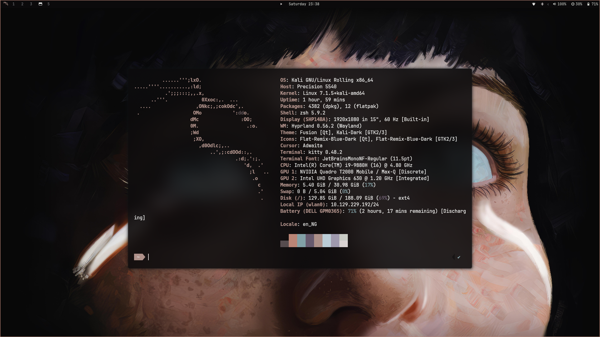

# 🌅 Last Horizon — Minimalist Obsidian Hyprland Rice

A clean, distraction-free, obsidian-accented desktop environment built on **Hyprland** (Wayland) with hardware acceleration tuned for NVIDIA Turing GPUs (Quadro T2000) and modern Linux distros (Kali / Debian / Arch).



---

## 🏗️ Architecture & Components

| Component | Software | Description |
| :--- | :--- | :--- |
| **Compositor** | [Hyprland](https://hyprland.org) | Wayland dynamic tiling compositor (includes both `.lua` & `.conf`) |
| **Status Bar** | [Waybar](https://github.com/Alexays/Waybar) | Top bar with Kali launcher, centered clock, volume & brightness sliders |
| **App Launcher** | [Rofi-Wayland](https://github.com/lbonn/rofi) | Raycast-style obsidian minimalist launcher & search |
| **Keybinds Cheatsheet** | [Rofi Modal](.config/rofi/keybinds.rasi) | Pixel-perfect monospace alignment (`JetBrainsMono Nerd Font Mono 11`) |
| **Power Menu** | [Rofi Modal](.config/rofi/powermenu.rasi) | Vertical modal popup (Lock, Suspend, Relaunch, Restart, Shutdown) |
| **Notification Center** | [SwayNC](https://github.com/ErikReider/SwayNotificationCenter) | Quick settings toggles with accent active pills (`#b59790`) & sliders |
| **Screen Lock** | [Hyprlock](https://github.com/hyprwm/hyprlock) | Blurred wallpaper lockscreen with clock and password pill |
| **Idle & Sleep Daemon** | [Hypridle](https://wiki.hyprland.org/Hypr-Ecosystem/hypridle) | Automatic lock before sleep/suspend & DPMS screen timeouts |
| **Wallpaper Daemon** | [Hyprpaper](https://github.com/hyprwm/hyprpaper) | Lightweight Wayland wallpaper renderer |
| **Terminal** | [Kitty](https://sw.kovidgoyal.net/kitty/) | Fast GPU-accelerated terminal matching obsidian theme (`#0c0b0c`) |

---

## 🎨 Color Palette & Aesthetic

- **Background (Obsidian Black)**: `#0c0b0c`
- **Foreground (Bone White)**: `#e2dddc`
- **Active Accent Pill**: `#b59790` (dark text `#0c0b0c`)
- **Accent Border**: `#c38b7b`
- **Muted Elements**: `#797b80`
- **Selection Highlight**: `rgba(255, 255, 255, 0.08)`

---

## ⌨️ Keybindings Cheat Sheet

The cheatsheet modal is built right into your desktop (`SUPER + K` or `SUPER + /`).

### Applications & Controls
| Shortcut | Action | Description |
| :--- | :--- | :--- |
| `SUPER + SPACE` | **Menu** | Open Rofi application launcher |
| `SUPER + RETURN` | **Terminal** | Launch Kitty terminal |
| `SUPER + B` | **Browser** | Launch default web browser |
| `SUPER + E` | **File manager** | Launch file manager (Thunar) |
| `SUPER + N` | **Notification center** | Toggle SwayNC control center |
| `SUPER + ESCAPE` | **Power menu** | Open vertical system power modal |
| `SUPER + K` / `SUPER + /`| **Keybindings** | Open interactive cheatsheet popup |

### Window Management
| Shortcut | Action | Description |
| :--- | :--- | :--- |
| `SUPER + Q` | **Close window** | Close the focused window |
| `SUPER + F` | **Fullscreen** | Toggle fullscreen mode |
| `SUPER + V` | **Floating** | Toggle floating / tiling mode |
| `SUPER + T` | **Split layout** | Toggle window layout direction |
| `SUPER + H / J / K / L` | **Focus window** | Focus Left / Down / Up / Right |
| `SUPER SHIFT + H / J / K / L`| **Move window** | Move window Left / Down / Up / Right |
| `SUPER ALT + H / J / K / L` | **Resize window** | Resize active window |
| `SUPER + Left Mouse (Drag)`| **Move floating** | Drag floating window |
| `SUPER + Right Mouse (Drag)`| **Resize floating**| Resize floating window |

### Workspaces
| Shortcut | Action | Description |
| :--- | :--- | :--- |
| `SUPER + [1..9]` | **Switch workspace** | Switch to workspace 1–9 |
| `SUPER SHIFT + [1..9]` | **Move to workspace** | Move focused window to workspace 1–9 |

### Screenshots
| Shortcut | Action | Description |
| :--- | :--- | :--- |
| `PRINT` | **Screenshot area** | Select rectangular region with `slurp` + `grim` |
| `SUPER + PRINT` | **Screenshot full screen** | Capture entire display |
| `SUPER SHIFT + PRINT` | **Screenshot active window**| Capture focused window only |

### Media & Hardware Keys
- **Volume Up / Down**: Capped at strictly 100% (scroll over top bar volume icon or use `XF86AudioRaiseVolume` / `XF86AudioLowerVolume`).
- **Volume Mute**: `XF86AudioMute` (shows muted glyph `󰝟 0%` when volume is zero).
- **Brightness Up / Down**: Scroll over top bar brightness icon or use `XF86MonBrightnessUp` / `XF86MonBrightnessDown`.

---

## 📦 Requirements & Dependencies

Ensure you have the following packages installed:

### Debian / Kali Linux:
```bash
sudo apt install -y hyprland waybar rofi-wayland sway-notification-center \
    hyprlock hypridle hyprpaper kitty grim slurp wl-clipboard \
    brightnessctl wireplumber fonts-jetbrains-mono
```

### Arch Linux:
```bash
sudo pacman -S hyprland waybar rofi-wayland swaync hyprlock hypridle \
    hyprpaper kitty grim slurp wl-clipboard brightnessctl \
    wireplumber ttf-jetbrains-mono-nerd
```

> [!NOTE]
> Make sure **JetBrainsMono Nerd Font** (and `JetBrainsMono Nerd Font Mono`) is installed for the cheatsheet and status bar icons to render with zero column offset.

---

## 🚀 Installation

1. **Clone the repository:**
   ```bash
   git clone git@github.com:DDreamer01/dotfiles.git ~/dotfiles
   cd ~/dotfiles
   ```

2. **Run the installation script:**
   ```bash
   ./install.sh
   ```
   *The installer automatically creates a timestamped backup of any existing configs in `~/.config_backup_<timestamp>` before symlinking the new configurations.*

3. **Reload your desktop:**
   ```bash
   hyprctl reload
   systemctl --user restart waybar
   swaync-client -R && swaync-client -rs
   systemctl --user restart hypridle
   ```

---

## 📂 Repository Structure

```
dotfiles/
├── .config/
│   ├── hypr/
│   │   ├── hyprland.conf       # Standard Hyprland config (NVIDIA Turing optimized)
│   │   ├── hyprland.lua        # Lua-based Hyprland config
│   │   ├── hypridle.conf       # Sleep and idle timeout manager
│   │   ├── hyprlock.conf       # Sleek blurred lockscreen
│   │   ├── hyprpaper.conf      # Wallpaper manager
│   │   ├── scripts/            # Keybinds, power menu, brightness, screenshot scripts
│   │   └── wallpapers/         # Obsidian & Last Horizon wallpapers
│   ├── waybar/
│   │   ├── config.jsonc        # Waybar layout & module configuration
│   │   ├── style.css           # Waybar styling
│   │   ├── btmenu.sh           # Bluetooth launcher
│   │   ├── bt.py               # Bluetooth status helper
│   │   └── media.py            # MPRIS media player status
│   ├── rofi/
│   │   ├── config.rasi         # Raycast search config
│   │   ├── lasthorizon.rasi    # Main launcher theme
│   │   ├── keybinds.rasi       # Monospace cheatsheet modal theme
│   │   └── powermenu.rasi      # Vertical power menu modal
│   ├── swaync/
│   │   ├── config.json         # Control center widgets & action grid
│   │   └── style.css           # Obsidian theme & active toggle highlight states
│   └── kitty/
│       └── kitty.conf          # GPU terminal configuration
├── assets/
│   └── preview.png             # Desktop preview screenshot
├── install.sh                  # Automated deployment & backup script
├── .gitignore
└── README.md
```

---

## 👤 Author

- **DDreamer01** — [GitHub Profile](https://github.com/DDreamer01)
